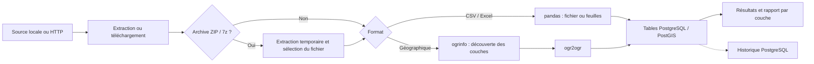

# GeoDataLab Ingestion

Bibliothèque Python d'ingestion de données géographiques et tabulaires dans
PostgreSQL/PostGIS. Elle récupère un fichier local ou distant, découvre ses
couches ou feuilles, puis les charge dans des tables en conservant un historique
et un résultat détaillé par couche.

## Table des matières

- [Fonctionnalités](#fonctionnalités)
- [Fonctionnement](#fonctionnement)
- [Prérequis et installation](#prérequis-et-installation)
- [Démarrage rapide](#démarrage-rapide)
- [Configuration](#configuration)
  - [Sources](#sources)
  - [Destination et modes de chargement](#destination-et-modes-de-chargement)
  - [Nommage des tables](#nommage-des-tables)
  - [Données tabulaires](#données-tabulaires)
  - [Géométries](#géométries)
  - [Archives ZIP et 7z](#archives-zip-et-7z)
- [Résultats et historique](#résultats-et-historique)
- [Organisation du dépôt](#organisation-du-dépôt)
- [Tests](#tests)

## Fonctionnalités

- Sources locales et HTTP, avec téléchargement en flux et nouvelles tentatives
  en cas de certaines interruptions réseau.
- Découverte des couches géographiques avec `ogrinfo` et chargement avec
  `ogr2ogr` ; formats courants : Shapefile, GeoPackage, GeoJSON, GML, KML,
  KMZ, FlatGeobuf, SQLite et Parquet, selon les pilotes GDAL disponibles.
- Chargement des CSV et fichiers Excel (`.xlsx`, `.xls`) avec pandas : une table
  par CSV ou par feuille Excel.
- Extraction des archives ZIP et 7z, sélection d'un jeu de données et prise en
  charge de ses fichiers associés.
- Chargement multicouche, reprojection géographique, modes de création,
  remplacement ou ajout, et normalisation des noms de tables.
- Résultats par couche, rapport lisible et historique persistant dans PostgreSQL.

## Fonctionnement



Le téléchargement HTTP est conservé sur disque. Les fichiers extraits d'une
archive sont placés dans un répertoire temporaire supprimé après l'ingestion,
y compris en cas d'échec.

## Prérequis et installation

- Python 3.13 (le projet déclare `~=3.13.0`) et [uv](https://docs.astral.sh/uv/).
- Les commandes GDAL `ogrinfo` et `ogr2ogr` accessibles dans le `PATH` pour les
  données géographiques.
- Une base PostgreSQL accessible avec PostGIS pour les données géographiques,
  et un utilisateur autorisé à créer et modifier les tables et schémas nécessaires.

Depuis le dépôt :

```sh
uv sync --locked --group dev
```

Pour utiliser la bibliothèque dans un autre projet uv, ajouter ce dépôt comme
dépendance Git, puis verrouiller la révision souhaitée :

```sh
uv add 'geodatalab-ingestion @ git+https://github.com/bdaniere/GeoDataLab-Ingestion.git'
```

## Démarrage rapide

Renseigner la connexion PostgreSQL dans l'environnement avant de lancer
l'ingestion :

```sh
export POSTGRES_HOST=localhost    # facultatif, localhost par défaut
export POSTGRES_PORT=5432         # facultatif, 5432 par défaut
export POSTGRES_DB=ma_base
export POSTGRES_USER=mon_utilisateur
export POSTGRES_PASSWORD='mon_mot_de_passe'
```

Il est aussi possible de définir `GEODATALAB_ENV_FILE` avec le chemin d'un
fichier dotenv contenant ces variables. Les variables déjà présentes dans
l'environnement ont priorité. Ne pas versionner les mots de passe.

Exemple d'ingestion d'un CSV local avec l'API Python :

```python
from geodatalab_ingestion.core.ingestion_report import IngestionReport
from geodatalab_ingestion.core.ingestion_runner import IngestionRunner
from geodatalab_ingestion.core.models import DestinationConfig, SourceConfig
from geodatalab_ingestion.core.sources.factory import SourceFactory

source_config = SourceConfig(
    name="population",
    source_type="local",
    location="/chemin/vers/population.csv",
    options={"read_options": {"sep": ";", "encoding": "utf-8"}},
)
destination = DestinationConfig(
    destination_type="postgis",
    schema="raw_data",
    options={"mode": "create"},
)

source = SourceFactory.create(source_config.source_type).extract(source_config)
result = IngestionRunner().run(source, destination)
print(IngestionReport.format_result(result))
if not result.success:
    raise SystemExit("Une ou plusieurs couches ont échoué.")
```

Pour une source distante, remplacer `source_type="local"` par `"http"` et
`location` par son URL. L'exemple [config/ingestion_example.json](config/ingestion_example.json)
illustre une configuration pour une application consommatrice : ce dépôt ne
fournit pas de commande qui lit directement ce fichier JSON. Les champs JSON
`type`, `mode` et `target_crs` doivent être adaptés aux objets Python décrits
ci-dessous.

## Configuration

### Sources

`SourceConfig` accepte `name` (nom logique), `source_type` (`local` ou `http`),
`location` (chemin ou URL) et un dictionnaire `options`. La fabrique
`SourceFactory` choisit le gestionnaire qui produit un `SourceData` pour le
runner.

Options utiles dans `SourceConfig.options` :

| Option | Utilisation |
| --- | --- |
| `filename` | Nom du fichier téléchargé en HTTP, notamment si l'URL ne contient pas d'extension. |
| `download_dir` | Répertoire de téléchargement HTTP ; utiliser un chemin absolu pour choisir explicitement son emplacement. |
| `headers` | En-têtes HTTP supplémentaires. |
| `read_options` | Options de lecture pandas pour un CSV ou un fichier Excel. |
| `archive_member` | Chemin exact du jeu de données à sélectionner dans une archive. |

### Destination et modes de chargement

`DestinationConfig` utilise `destination_type="postgis"` et un `schema` qui vaut
`raw_data` par défaut. Ne pas renseigner `table` avec `IngestionRunner` : il
détermine les tables à partir du nom de source et des couches. Dans l'API Python,
les options suivantes se placent dans `DestinationConfig.options` :

| Option | Effet |
| --- | --- |
| `mode` | `create` (défaut) échoue si la table existe ; `overwrite` la remplace ; `append` ajoute à une table existante compatible. |
| `target_crs` | Code EPSG cible pour la reprojection des données géographiques, par exemple `2154`. |
| `promote_to_multi` | Booléen contrôlant la conversion OGR vers des géométries multiples. |

Pour les données tabulaires, chaque table est chargée dans une transaction.

### Nommage des tables

Une source à une seule couche ou feuille utilise le `name` normalisé de la
source. Avec plusieurs couches ou feuilles, le nom combine celui de la source
et celui de la couche, séparés par `_`. Les noms sont convertis en identifiants
ASCII minuscules de 63 caractères maximum ; les collisions provoquent une erreur.
Cette règle s'applique aussi aux archives.

Cette convention remplace l'ancien nommage basé sur le fichier : les tables
existantes ne sont ni renommées ni supprimées. Vérifier les noms avant d'utiliser
`append` ou `overwrite` avec une ancienne configuration.

### Données tabulaires

Un CSV est chargé dans une table ; chaque feuille Excel est chargée dans sa
propre table. Les CSV contenant des coordonnées restent des tables non
géographiques : aucune géométrie n'est créée.

`read_options` est facultatif. Pour les CSV, les options acceptées sont `sep`,
`encoding`, `decimal`, `dtype` et `header` ; pour Excel, `dtype` et `header`.
Elles sont transmises à pandas. Les types sont inférés par défaut : utiliser
`dtype` pour préserver, par exemple, les zéros initiaux des codes postaux.
`target_crs` ne s'applique pas aux données tabulaires.

### Géométries

Par défaut, les polygones d'un Shapefile sont promus en MultiPolygon afin
d'accepter les entités Polygon et MultiPolygon dans la même table PostGIS,
y compris lorsque le Shapefile provient d'une archive. Les points, lignes et
autres formats conservent leur comportement par défaut.

Utiliser `options={"promote_to_multi": True}` pour demander la promotion à OGR
pour d'autres formats ou géométries, ou `False` pour désactiver la promotion
automatique. En mode `append`, la colonne géométrique existante doit être
compatible : la promotion ne la modifie pas. Désactiver la promotion peut faire
échouer le chargement de polygones mixtes.

### Archives ZIP et 7z

Les archives locales ou HTTP sont reconnues par leur extension ou leur contenu.
Si une URL HTTP n'a pas d'extension, `options={"filename": "donnees.zip"}` peut
en préciser une. Les formats tels que XLSX et KMZ, qui sont eux-mêmes des
conteneurs ZIP, restent traités directement par leurs chargeurs.

Si l'archive contient un seul jeu de données reconnu, il est sélectionné
automatiquement. Les extensions reconnues sont CSV, XLSX, XLS, SHP, GPKG,
GeoJSON, JSON, GeoJSONL, NDJSON, GML, KML, KMZ, FGB, SQLite et Parquet. Les
fichiers associés des Shapefiles ne comptent pas comme jeux de données.
Si plusieurs jeux sont présents, ou pour sélectionner un autre format pris en
charge par OGR, indiquer son chemin exact, sensible à la casse :

```python
options = {"archive_member": "geographic/communes.shp"}
```

Tous les fichiers de l'archive sont extraits ensemble pour conserver les
fichiers associés (`.dbf`, `.shx`, `.prj`, etc.). Les chemins dangereux, liens,
fichiers spéciaux, éléments chiffrés et chemins dupliqués sont rejetés. La limite
est de 10 000 entrées et 10 Gio décompressés ; les archives imbriquées ne sont
pas extraites récursivement.

## Résultats et historique

`IngestionRunner.run` renvoie un `MultiLayerIngestionResult` : succès global,
durée, nombre de couches réussies ou échouées, compteurs agrégés et
`layer_results` contenant les détails et erreurs par couche. Les compteurs
indisponibles sont représentés par `None`. `IngestionReport.format_result`
produit un rapport texte ; les feuilles et lignes y utilisent la terminologie
des couches et entités.

Le runner tente de créer le schéma `ingestion_meta` et les tables `ingestions`
et `layer_ingestions` pour enregistrer les statuts, compteurs, erreurs et
métadonnées. Si l'historique ne peut pas être initialisé ou enregistré,
l'erreur est journalisée et l'ingestion continue sans garantie d'historique.
Les échecs de chargement d'une couche sont signalés dans son résultat ; d'autres
erreurs, notamment lors de la préparation ou de la découverte, peuvent lever
une exception avant la production du résultat.

## Organisation du dépôt

```text
src/geodatalab_ingestion/
├── core/        modèles, sources, orchestration, historique et rapports
├── extraction/ archives et découverte des couches
└── loaders/     chargement géographique (OGR) et tabulaire (pandas)
config/          exemple de configuration pour une application consommatrice
tests/           tests unitaires, d'intégration et jeux de données
```

## Tests

```sh
uv run --no-sync pytest
```

Les tests PostGIS nécessitent `ogrinfo`, `ogr2ogr` et une base de test. Sans
`TEST_POSTGIS_DSN`, ils sont ignorés. Pour les activer, fournir une chaîne de
connexion psycopg2 contenant `host`, `port`, `dbname`, `user` et `password`.
L'utilisateur doit pouvoir créer et supprimer des schémas de test. Le workflow
[.github/workflows/tests.yml](.github/workflows/tests.yml) montre un exemple
avec un service PostGIS.
